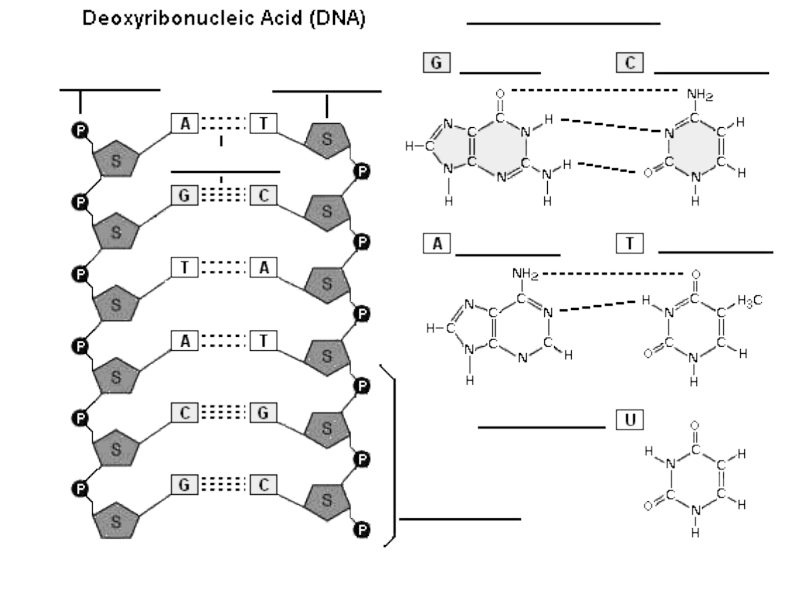

# Exercise Sheet 01 - Introduction to big data analysis in bioinformatics

## Exercise 01

**Question:** What are the complementary nucleotides in DNA?

**Answer:**

DNA strands are held together by hydrogen bonds between bases on adjacent strands.
Adenine (A) always pairs with thymine (T), while guanine (G) always pairs with cytosine (C).
Adenine pairs with uracil (U) in RNA.

## Exercise 02

(Top to bottom, Left to Right)
- Nucleotide
- Nucleotide chain
- G: Guanine
- C: Cytosine
- A: Adenine
- T: Thymine
- U: Uracil
- Sugar-phosphate backbone

## Exercise 03

**Question:** Explain the central dogma of molecular biology.

**Answer:** 

- The central dogma of molecular biology is a theory stating that genetic information flows only in one direction, from DNA, to RNA, to protein, or RNA directly to protein.
- The fundamental theory of central dogma was developed by Francis Crick in 1958. 
- His version was a bit more global and included the notion that information does not flow from proteins to nucleic acids. 
- Scientists have since discovered several exceptions to the theory. 
- On particularly notable example is that of prions. 
- Prions are infectious proteins which replicate without going through DNA or RNA intermediates.

# Exercise 4

**Question:**

`CAGUAUGUCAGCUGGAGUUCUAUAAACAAUUUGGUGAAGAAGG`

i. What must the DNA double strand look like, from which this mRNA got transcribed (assuming there was no splicing)?
ii. Which protein would the ribosomes of a human cell translate from the mRNA molecule above?
iii. If the same mRNA got translated in a cell of the ciliate Tetrahymena thermophila, what would be the resulting protein sequence?

**Answer:**

i. 
- Given RNA (5' to 3'): `CAGUAUGUCAGCUGGAGUUCUAUAAACAAUUUGGUGAAGAAGG`
- DNA Strand (5' to 3'): `CAGTATGTCAGCTGGAGTTCTAUAAACAATTTGGUGAAGAAGG`
- DNA Strand (3' to 5'): `GTCATACAGTCGACCTCAAGATATTTGTTAAACCACTTCTTCC`

ii.

CGAU **AUG UCA GCU GGA GUU CUA UAA** ACAAUUUGGUGAAGAAGG

Therefore, the peptide it transforms into is:
_Met-Ser-Ala-Ala-Leu-*_

iii.

CGAU **AUG UCA GCU GGA GUU CUA UAA ACA AUU UGG UGA** AGAAGG

Therefore, the peptide it transforms into is:
_Met-Ser-Ala-Val-Leu-Gln-Thr-Ile-*_

