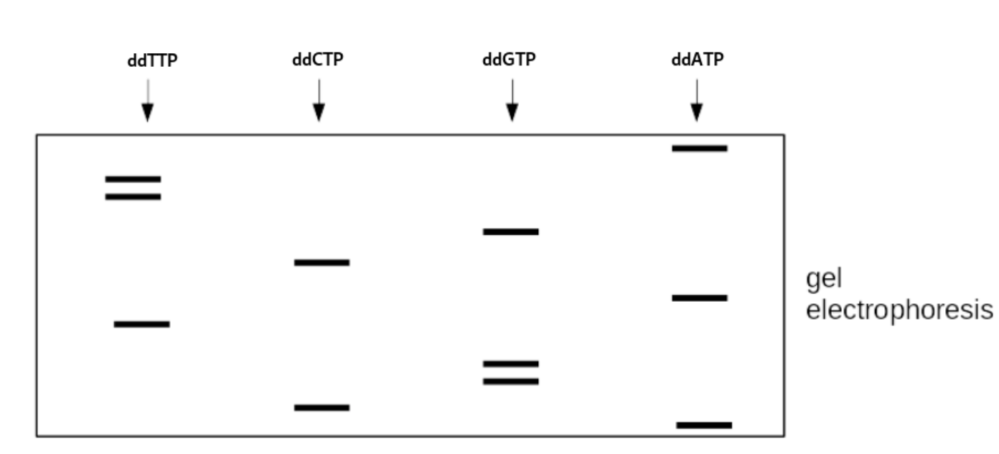
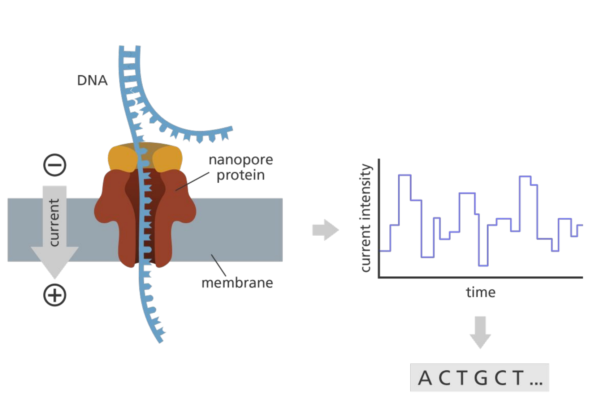
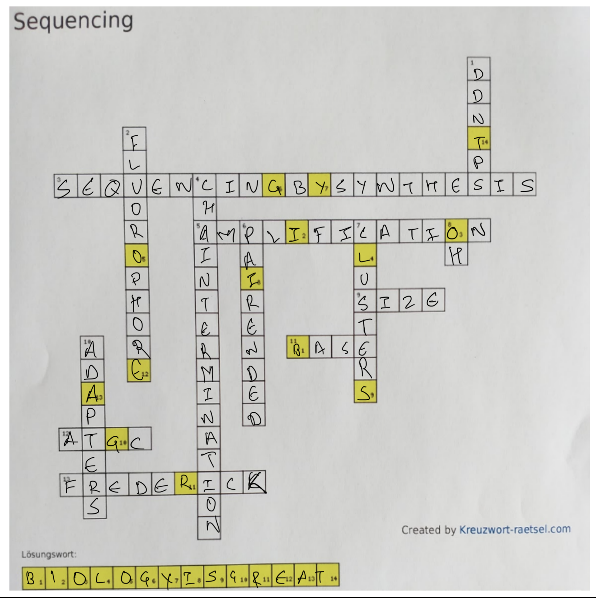
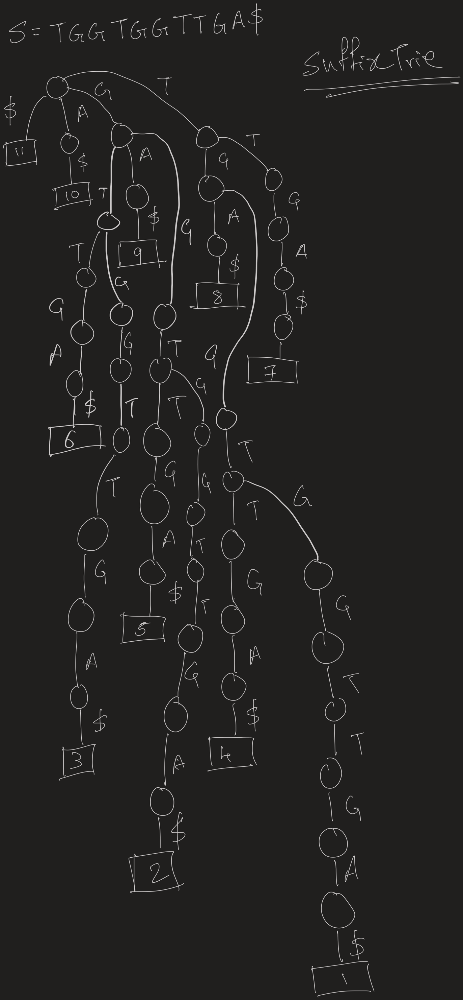

# Exercise Sheet 02 - Sequencing

## Exercise 01

**Question:**

The chain termination “Sanger sequencing” method is based on the addition of dideoxynucleotides, which terminate DNA synthesis, to a complementary strand synthesis reaction.
Below is a schematic drawing of a Sanger sequencing gel run used to separate reaction products.
Can you deduce:

i. the sequence of the newly synthesized strand

ii. the sequence of the template strand

**Answer:**

i. `ACGGTACGTTA`

ii. The template strand is the reverse complement:

Reversing the strand: `ATTGCATGGCA`
Complementing the reversed strand: `TAACGTACCGT`

## Exercise 02

**Question**

Please arrange the following terms into their correct order in the Illumina sequencing method and describe each of them briefly:
- bridge amplification
- deblocking
- library preparation
- annealing of template strands to flow cell
- fluorescence detection

**Answer**

1. Library Preparation: 
   1. A sequencing library gets prepared from a sample by fragmenting the original DNA and adding Illumina-specifc adapter sequences to both ends of the fragments. 
   2. The library is what gets read during sequencing.
2. Template strand annealing:
   1. The single-stranded library fragments are used as template strands in the sequencing.
   2. These are then annealed to primer sequences, which are bound to the flow cell.
   3. They are complementary to the adapter sequences of the fragments.
3. Bridge Amplifications:
   1. This happens after complementary strands have been synthesized and the templates been washed off.
   2. The now flow cell-bound fragments are amplified in several cycles of so-called bridge-amplification.
   3. This forms fragment colonies, or clusters, on the flow cell to guarantee a detectable fluorescence signal during sequencing.
4. Fluorescence Detection:
   1. Illumina-sequencing is a form of sequencing-by-synthesis, in which the nucleotides incorporated into the growing strand are detected via attached fluorophores. 
   2. After the first 3 steps, the following steps are iterated to sequence the entire read:
      1. Modified nucleotides, containing a flurorescent group, are used to extend the strand. 
      2. After fluorescence detection of the newly incorporated nucleotides, their blocking groups are cleaved from their 3’-OH groups.
5. Deblocking:
   1. Deblocking is the removal of the fluorophore ("blocking group"). 
   2. It is necessary before a new round of elongation by one nucleotide can begin.

## Exercise 03:

**Question**

Describe the mechanism of the Oxford nanopore sequencing technique, explain 2D-sequencing and collect pros and cons compared to Illumina sequencing.

**Answer**

- ONT flow cells are controlled by an electronic chip that sits just under an artificial membrane containing hundreds or thousands of these protein nanopores.
- A voltage is set across the membrane attracting negatively charged DNA molecules through the nanopores, obstructing the current across the membrane.
- Because the 4 bases of DNA have different shapes and sizes, they lead to different current variations when moving through a nanopore.
- These current variations make up ONT’s raw data.
- A base-calling algorithm then converts the current variation traces into a sequence, each intensity step corresponding to the multiple bases obstructing the pore at a certain time.

2D Sequencing:

- 2D sequencing refers to the sequencing of both forward and reverse strands, to improve the accuracy. 
- This is achieved by ligating (joining) the two DNA strands.
- When using the 2D chemistry both the template and complement are sequenced as they are link together with a hairpin (yellow).

Pros:

- Can sequence ultra long reads (~10-100 kilo-bases)
- Portable
- Cost-effective: Costs around 1000 USD vs the Illumina apparatus which causes 1M USD
- Faster turnaorund and sequencing times &mdash; immediate availability vs 3 days for Illumina

Cons:

- Low accuracy with high error rates (around 10-15%)
- Higher cost per giga-base (around 80 dollars)

