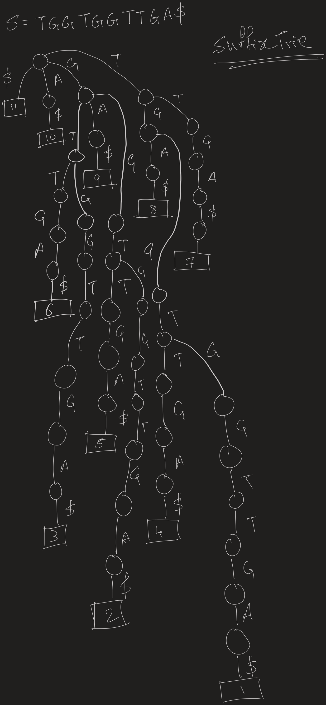
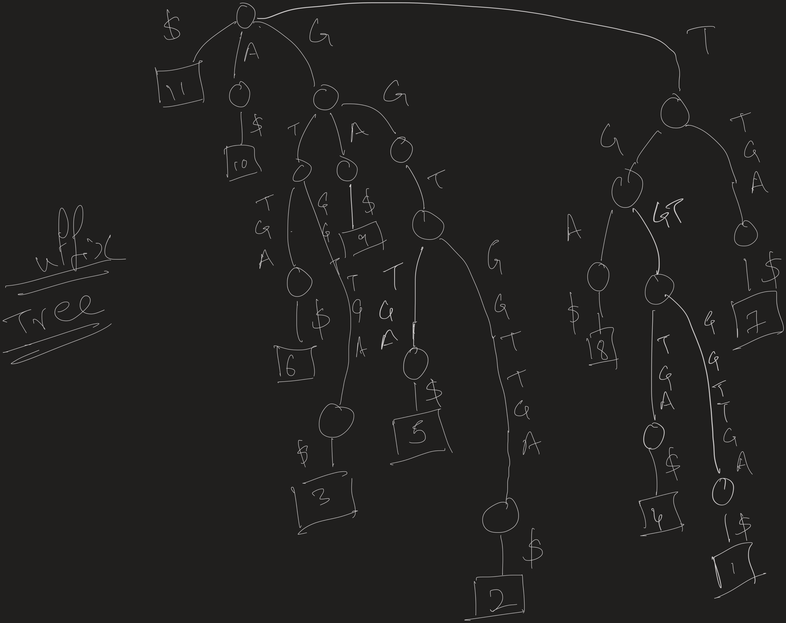
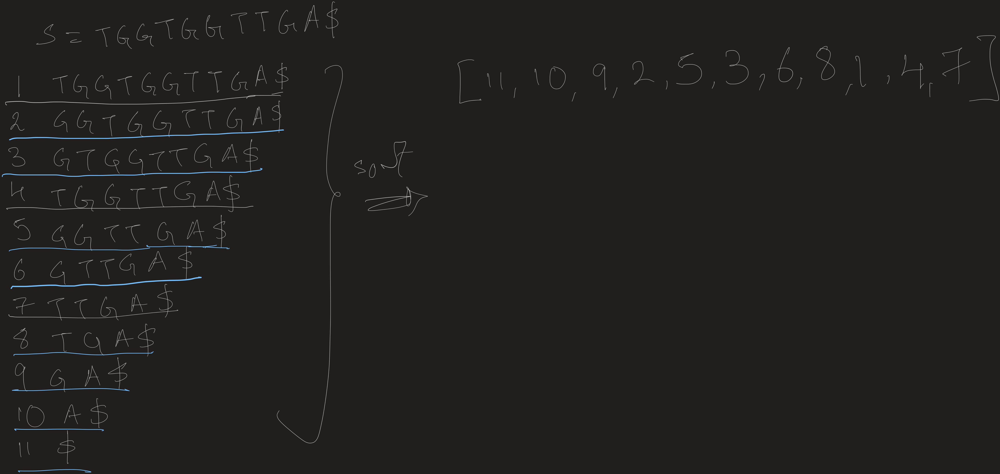
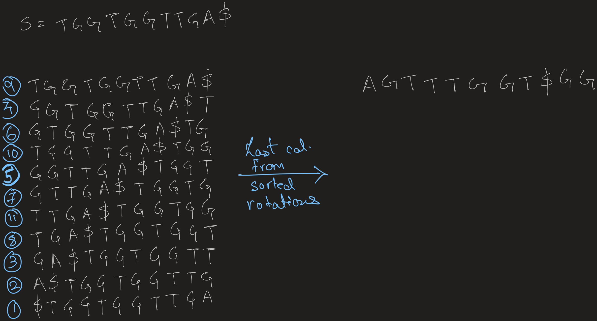
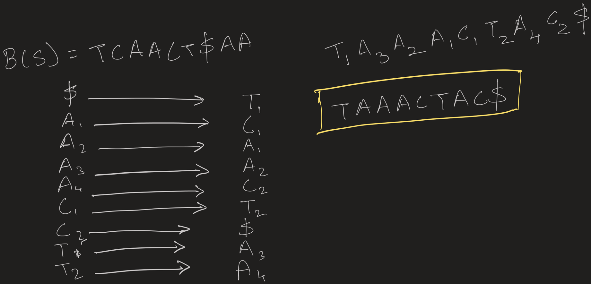

# Exercise Sheet 04 - Read Mapping

## Exercise 1

**Question**

Given the array S = TGGTGGTTGA$. Extract the:

(a) suffix trie
(b) suffix tree
(c) suffix array

**Answer**

(a) 

(b) 

(c) 

## Exercise 2

**Question**

(a) Extract the Burrows-Wheeler Transform B(S) of S = TGGTGGTTGA$.

(b) Invert the Burrows-Wheeler-Transform B(S) = T CAACT$AA to obtain S.

(c) Search for CAT in B(S) = T CAACT$AA.

**Answer**

(a) 

(b) 

(c) 