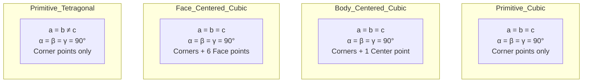
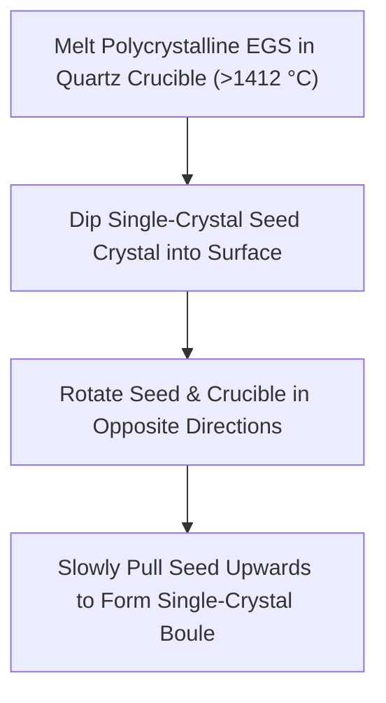
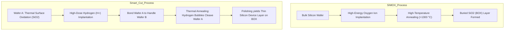

# Topic C: Semiconductor & MEMS Materials
**Course**: Microsystems Technologies and Processes (University of Freiburg)  
**Sources**: *Lecture Notes, MEMS Materials.pdf*; *Rapp (2017)*

---

## Part 1: Semiconductor Materials & Physical Properties

### Question 1.1: Common Semiconductor Materials & Selection Criteria
* **Question**: *Name two common semiconductor materials used in MEMS/microelectronics and state their most outstanding physical properties for which they would be chosen in an application.*  
* **Exam Appearances**: *SS 2023 (Q3.1–3.2)*

#### Solution:

1. **Silicon (Si)**:
   * **Outstanding Properties**: High mechanical Young's modulus ($\\sim 185\text{ GPa}$) providing excellent structural stiffness, high thermal conductivity ($1.3\text{ W}/(\text{cm}\cdot\text{K})$), high abundance, and the unique ability to form a high-quality, stable native thermal insulator ($\text{SiO}_2$) with extremely low interface state density.
2. **Gallium Arsenide (GaAs)**:
   * **Outstanding Properties**: Direct optical band gap ($1.42\text{ eV}$) allowing efficient light emission (optoelectronics), and an extremely high electron mobility ($8500\text{ cm}^2/(\text{V}\cdot\text{s})$ compared to $1400\text{ cm}^2/(\text{V}\cdot\text{s})$ for Si), making it ideal for ultra-high-frequency/high-speed electronics.

---

## Part 2: Crystallography, Bravais Lattices & Plane Angles

### Question 2.1: Bravais Lattices
* **Question**: *Name and sketch 4 different Bravais lattices.*  
* **Exam Appearances**: *SS 2020 (Q3.3), SS 2023 (Q3.3)*

#### Solution:
There are **14 distinct 3D Bravais lattices** categorized across 7 crystal systems. Four examples include:

1. **Primitive Cubic (sc)**: Lattice parameters $a = b = c$, $\alpha = \beta = \gamma = 90^\circ$; atoms located exclusively at the 8 unit cell corners.
2. **Body-Centered Cubic (bcc)**: Lattice parameters $a = b = c$, $\alpha = \beta = \gamma = 90^\circ$; atoms located at the 8 unit cell corners plus 1 atom at the geometric center of the body.
3. **Face-Centered Cubic (fcc)**: Lattice parameters $a = b = c$, $\alpha = \beta = \gamma = 90^\circ$; atoms located at the 8 unit cell corners plus 1 atom at the center of each of the 6 faces.
4. **Primitive Tetragonal**: Lattice parameters $a = b \neq c$, $\alpha = \beta = \gamma = 90^\circ$; atoms located exclusively at unit cell corners.

* **Diagram Reference**:
  > **Source Location**: *Lecture Notes, MEMS Materials.pdf*, slide titled **"The 14 Bravais lattices"** (showing the 3D unit cell drawings for cubic, tetragonal, orthorhombic, monoclinic, triclinic, hexagonal, and rhombohedral lattices).

---

### Question 2.2: Analytical Derivation of Plane Angles in Silicon
* **Question**: *Calculate the angle $\theta$ between the (100) plane and the (111) plane in a cubic silicon unit cell.*  
* **Exam Appearances**: *WS 2019/2020 (Q3.4), SS 2020 (Q3.4), SS 2022 (Q5.3), WS 2024/2025 (Q3.1)*

#### Step-by-Step Derivation:
1. **Define Normal Vectors**:
   In a cubic crystal system, the normal vector $\vec{n}$ to a crystal plane $(h k l)$ is directly defined by its Miller indices $[h, k, l]$.
   * Normal vector to $(100)$ plane: $\vec{n}_1 = [1, 0, 0]$.
   * Normal vector to $(111)$ plane: $\vec{n}_2 = [1, 1, 1]$.

2. **Apply Vector Dot Product Formula**:
   The angle $\theta$ between two planes corresponds to the angle between their respective normal vectors:
   $$\cos \theta = \frac{\vec{n}_1 \cdot \vec{n}_2}{|\vec{n}_1| \cdot |\vec{n}_2|} = \frac{h_1 h_2 + k_1 k_2 + l_1 l_2}{\sqrt{h_1^2 + k_1^2 + l_1^2} \cdot \sqrt{h_2^2 + k_2^2 + l_2^2}}$$

3. **Substitute Values**:
   $$\vec{n}_1 \cdot \vec{n}_2 = (1)(1) + (0)(1) + (0)(1) = 1$$
   $$|\vec{n}_1| = \sqrt{1^2 + 0^2 + 0^2} = 1$$
   $$|\vec{n}_2| = \sqrt{1^2 + 1^2 + 1^2} = \sqrt{3}$$

4. **Calculate Angle**:
   $$\cos \theta = \frac{1}{1 \cdot \sqrt{3}} = \frac{1}{\sqrt{3}} \approx 0.57735$$
   $$\theta = \arccos\left(\frac{1}{\sqrt{3}}\right) \approx 54.74^\circ$$

* **Result**: The angle between the $\{100\}$ surface plane and the $\{111\}$ slow-etch plane is **$54.74^\circ$**.

---

## Part 3: Wafer Types & Flat Identification

### Question 3.1: Identifying Wafer Orientation & Doping from Flats
* **Question**: *State the wafer orientation and doping type for standard SEMI wafer flat configurations.*  
* **Exam Appearances**: *SS 2020 (Q3.5)*

#### Solution:
On standard silicon wafers ($\\le 150\text{ mm}$ diameter), crystal orientation and doping type are indicated by the relative angular position of the primary and secondary flats:

1. **p-type (100)**: Primary flat present; secondary flat located at **$90^\circ$** clockwise/counter-clockwise relative to the primary flat.
2. **n-type (100)**: Primary flat present; secondary flat located at **$45^\circ$** relative to the primary flat.
3. **p-type (111)**: **Primary flat only** (no secondary flat).
4. **n-type (111)**: Primary flat present; secondary flat located at **$180^\circ$** (directly opposite) the primary flat.

*Note*: Wafers $> 150\text{ mm}$ use laser-engraved notches instead of flats for automated alignment.
* **Diagram Reference**:
  > **Source Location**: *Lecture Notes, MEMS Materials.pdf*, slide titled **"Reading wafer orientation"** (illustrating the four SEMI flat configuration diagrams).

---

## Part 4: Crystal Defects Classification (0D to 3D)

### Question 4.1: Classification of Crystal Defects
* **Question**: *Classify crystal defects by their dimensionality (0D to 3D) and give a brief explanation for each defect type.*  
* **Exam Appearances**: *WS 2019/2020 (Q3.5–3.6), SS 2022 (Q5.1), WS 2024/2025 (Q3.3)*

#### Solution:

1. **Zero-Dimensional (0D) / Point Defects**:
   * **Vacancy**: A missing atom at a regular lattice position.
   * **Frenkel Defect**: A vacancy-interstitial pair formed when an atom leaves its site and moves into an interstitial position.
   * **Schottky Defect**: A vacancy formed when an atom migrates all the way to the crystal surface.
   * **Self-Interstitial**: An extra native atom squeezed into the space between regular lattice sites.
   * **Substitutional Impurity**: A native lattice atom replaced by a foreign atom (e.g., dopant).
   * **Antisite Defect**: In multi-element lattices, two neighboring atoms of different species swap positions.

2. **One-Dimensional (1D) / Line Defects**:
   * **Step / Edge Dislocation**: Occurs when an extra half-plane of atoms abruptly terminates inside the crystal, causing surrounding planes to distort.
   * **Helical / Screw Dislocation**: Occurs when a crystal plane is sheared along its surface, producing a spiral staircase defect line propagating through the lattice.

3. **Two-Dimensional (2D) / Planar Defects**:
   * **Grain Boundaries**: Interfaces separating regions of different crystalline orientation in polycrystalline materials.
   * **Twin Boundary**: A single shifted plane that creates a crystal region exhibiting mirror symmetry across the boundary plane.
   * **Intrinsic Stacking Fault**: Disruption where one atomic layer is missing from the periodic stacking sequence (e.g., $ABC\mathbf{AC}ABC$).
   * **Extrinsic Stacking Fault**: Disruption where an additional atomic layer is inserted into the sequence (e.g., $ABC\mathbf{ABCC}ABC$).

4. **Three-Dimensional (3D) / Volume Defects**:
   * **Precipitates**: Clusters or bulk second-phase impurity concentrations embedded within the crystal volume.
   * **Voids**: Microscopic three-dimensional empty cavities or vacancy clusters breaking the crystal lattice.

---

## Part 5: Single-Crystal Growth (Czochralski vs. Float-Zone)

### Question 5.1: Czochralski (CZ) vs. Float-Zone (FZ) Process Comparison
* **Question**: *Sketch and explain the Czochralski (CZ) process. Compare the CZ and Float-Zone (FZ) processes in terms of setup, maximum wafer diameter, oxygen contamination, resistivity, cost, and dopant distribution.*  
* **Exam Appearances**: *SS 2022 (Q5.2), SS 2023 (Q3.4), WS 2024/2025 (Q3.2)*

#### Solution:

1. **Czochralski (CZ) Process Mechanism**:
   * High-purity Electronic Grade Silicon (EGS) is placed inside a fused silica ($\text{SiO}_2$) quartz crucible mounted in a graphite container and heated above $1412^\circ\text{C}$ in an inert atmosphere or vacuum.
   * A single-crystalline seed crystal with the desired crystal orientation is lowered into the molten silicon.
   * The seed crystal and crucible are rotated in opposite directions while the seed is pulled slowly upward, solidifying a large single-crystalline ingot (boule).

2. **CZ vs. FZ Comparison Table**:

| Property | Czochralski (CZ) Process | Float-Zone (FZ) Process | Source Citation |
| :--- | :--- | :--- | :--- |
| **Melting Setup** | Entire silicon volume is molten inside a quartz crucible | Small localized zone is molten via RF induction coil ($446\text{ MHz}$) without crucible contact | *MEMS Materials.pdf* |
| **Max Wafer Diameter** | Large ($> 30\text{ cm} / 12''$) | Limited ($\\le 15\text{ cm} / 6''$) due to surface tension limits of the molten zone | *MEMS Materials.pdf* |
| **Oxygen Contamination** | **High** (oxygen dissolves into melt from quartz $\text{SiO}_2$ crucible) | **Extremely Low** / below detection limit (crucible-free) | *MEMS Materials.pdf* |
| **Purity & Resistivity** | Lower purity; resistivity $\\sim 50\,\Omega\cdot\text{cm}$ | Ultra-high purity ($1\text{ ppb}$); resistivity $> 200\,\text{k}\Omega\cdot\text{cm}$ | *MEMS Materials.pdf* |
| **Process Cost** | Low | High | *MEMS Materials.pdf* |
| **Dopant Distribution** | Irregular axial distribution | Very regular/uniform distribution | *MEMS Materials.pdf* |

* **Diagram Reference**:
  > **Source Location**: *Lecture Notes, MEMS Materials.pdf*, slides titled **"Czochralski Process: General setup"** and **"Float-Zone Process: Singlecrystalline Silicon"** (showing the crucible setup vs. RF heating coil setup).

---

## Part 6: Silicon-on-Insulator (SOI) Manufacturing

### Question 6.1: SIMOX vs. Smart Cut Process Workflows
* **Question**: *Sketch and explain the two main processes used for manufacturing Silicon-on-Insulator (SOI) wafers.*  
* **Exam Appearances**: *WS 2024/2025 (Q3.4)*

#### Solution:

1. **SIMOX Process (Separation by IMplantation of OXygen)**:
   * **Step 1**: High-energy, high-dose oxygen ions ($\text{O}^+$) are implanted deep into a bulk single-crystal silicon wafer to create a buried oxygen-rich concentration layer.
   * **Step 2**: High-temperature annealing ($>1300^\circ\text{C}$) reacts the buried oxygen with silicon to form a continuous buried oxide ($\text{SiO}_2$) layer beneath a high-quality single-crystal silicon surface layer.

2. **Smart Cut Process (Wafer Bonding & Hydrogen Cleavage)**:
   * **Step 1**: Donor Wafer A is thermally oxidized to grow a $\text{SiO}_2$ layer.
   * **Step 2**: High-dose Hydrogen ions ($\text{H}^+$) are implanted through the oxide into Wafer A to form a micro-cavity/hydrogen-rich cleavage plane at a controlled depth.
   * **Step 3**: Wafer A is flipped and thermally bonded to a secondary handle Silicon Wafer B.
   * **Step 4**: Thermal treatment causes hydrogen micro-bubbles to expand, mechanically cleaving Wafer A along the implantation plane.
   * **Step 5**: Surface polishing yields a smooth, ultra-thin single-crystal silicon device layer sitting on top of the buried oxide on Wafer B.

* **Diagram Reference**:
  > **Source Location**: *Lecture Notes, MEMS Materials.pdf*, slide titled **"Common wafer variants: SOI – the SIMOX Process"** (illustrating side-by-side schematics of SIMOX vs Smart Cut workflows).
