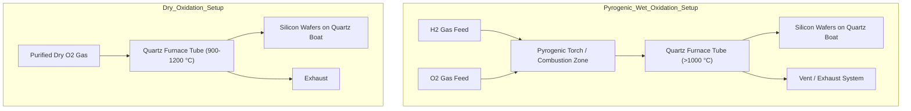

# Topic D: Thermal Oxidation of Silicon (Deal-Grove Model)
**Course**: Microsystems Technologies and Processes (University of Freiburg)  
**Sources**: *Lecture Slides: Oxidation of Silicon.pdf*; *Deal & Grove (1965)*; *Rapp (2017)*

---

## Part 1: Chemical Oxidation Reactions & Process Setups

### Question 1.1: Chemical Reactions for Thermal Oxidation
* **Question**: *State the chemical reaction equations for (a) wet chemical oxidation, (b) dry chemical oxidation, and (c) pyrogenic wet chemical oxidation of silicon.*  
* **Exam Appearances**: *WS 2019/2020 (Q2.1–2.3)*

#### Solution:
1. **Dry Chemical Oxidation**:
   $$\text{Si} + \text{O}_2 \rightarrow \text{SiO}_2$$
   * **Source**: *Lecture Slides: Oxidation of Silicon.pdf* (slide "Experiment and theory for dry oxidation").

2. **Wet Chemical Oxidation**:
   $$\text{Si} + 2\text{H}_2\text{O} \rightarrow \text{SiO}_2 + 2\text{H}_2\text{(g)}$$
   * **Source**: *Lecture Slides: Oxidation of Silicon.pdf* (slide "Experiment and theory for wet oxidation").

3. **Pyrogenic Wet Chemical Oxidation**:
   $$\text{Si} + 2\text{H}_2 + \text{O}_2 \rightarrow \text{Si} + 2\text{H}_2\text{O} \rightarrow \text{SiO}_2 + 2\text{H}_2\text{(g)}$$
   * **Mechanism**: Water vapor is produced *in-situ* inside the furnace combustion zone by igniting direct hydrogen ($\text{H}_2$) and oxygen ($\text{O}_2$) gas feeds prior to reaching the silicon wafer.
   * **Source**: *Lecture Slides: Oxidation of Silicon.pdf* (slide "Pyrogenic wet oxidation").

---

### Question 1.2: Equipment Setups for Dry & Pyrogenic Wet Oxidation
* **Question**: *Sketch and explain the setups used for dry oxidation and pyrogenic wet chemical oxidation of silicon.*  
* **Exam Appearances**: *WS 2019/2020 (Q2.4)*, *SS 2021 (Q2.3)*, *WS 2024/2025 (Q4.1)*, *SS 2025 (Q2.3)*

#### Solution & System Setup:

1. **Dry Oxidation System Components**:
   * **Gas Inlet**: Ultra-pure carrier gas ($D\text{ry }\text{O}_2$) passing through moisture filters.
   * **Furnace**: High-temperature quartz tube furnace enclosed in resistive heating coils maintained between $900^\circ\text{C}$ and $1200^\circ\text{C}$.
   * **Quartz Boat**: Holds the vertically or horizontally stacked silicon wafers inside the uniform heating zone.

2. **Pyrogenic Wet Oxidation System Components**:
   * **Dual Gas Feeds**: High-purity Hydrogen ($\text{H}_2$) and Oxygen ($\text{O}_2$) regulated mass flow controllers.
   * **Burner / Pyrogenic Torch**: External quartz combustion chamber where $\text{H}_2$ burns in excess $\text{O}_2$ to generate ultra-pure steam ($2\text{H}_2 + \text{O}_2 \rightarrow 2\text{H}_2\text{O}$) without metal ion contamination.
   * **Furnace Tube**: Directs steam across wafers inside the quartz tube furnace.
* **Diagram Reference**:
  > **Source Location**: *Lecture Slides: MST Technologies and Processes, Oxidation of Silicon.pdf*, slides titled **"Dry oxidation"** and **"Pyrogenic wet oxidation"**.

---

## Part 2: Deal-Grove Model Kinetics, Regimes & Variables

### Question 2.1: Model Identification & Variable Definitions
* **Question**: *What is the most common model used for the thermal oxidation of silicon? State the physical variables used in this model.*  
* **Exam Appearances**: *WS 2018/2019 (Q3.1)*, *SS 2021 (Q2.1)*, *WS 2021/2022 (Q4.1)*, *SS 2022 (Q4.1)*, *WS 2022/2023 (Q2.1)*, *SS 2023 (Q4.1)*, *SS 2024 (Q4.1)*, *WS 2024/2025 (Q4.2)*, *SS 2025 (Q2.1)*

#### Solution:
1. **Model Name**: **Deal-Grove Model** (developed by B. E. Deal and A. S. Grove, 1965).
2. **Physical Variables**:
   * $D$ (or $D_{\text{eff}}$): Diffusivity / diffusion coefficient of oxidant molecules in silicon dioxide ($\text{SiO}_2$) ($\text{cm}^2/\text{s}$ or $\mu\text{m}^2/\text{h}$).
   * $k$: Chemical reaction rate constant for the reaction of silicon to silicon dioxide at the $\text{Si/SiO}_2$ interface ($\text{cm/s}$ or $\mu\text{m/h}$).
   * $N$ (or $N_c$): Number of oxidant molecules incorporated into a unit volume of oxide layer ($N = 2.2 \times 10^{22}\ \text{cm}^{-3}$ for dry $\text{O}_2$; $N = 4.4 \times 10^{22}\ \text{cm}^{-3}$ for wet $\text{H}_2\text{O}$).
   * $C_0$: Equilibrium / ambient concentration of oxidant at the outer oxide surface ($\text{molecules/cm}^3$).
   * $A$: First linear-parabolic simplification factor defined as $A = \frac{2D}{k}$ ($\mu\text{m}$).
   * $B$: Second simplification factor / parabolic rate constant defined as $B = \frac{2DC_0}{N}$ ($\mu\text{m}^2/\text{h}$).

---

### Question 2.2: Analytical Flux Equations & Derivation of Growth Quadratic
* **Question**: *Derive the quadratic growth equation $x^2 + Ax - Bt = 0$ starting from flux balance conditions.*  
* **Exam Appearances**: *Theoretical derivation based on Deal-Grove fundamentals*

#### Step-by-Step Mathematical Derivation:
1. **Steady-State Flux Balance**:
   The growth process assumes three sequential fluxes in steady-state ($F = F_1 = F_2$):
   * **Diffusive Transport Flux ($F_1$)** through oxide layer of thickness $x$:
     $$F_1 = D \cdot \frac{C_0 - C_s}{x}$$
   * **Chemical Reaction Flux ($F_2$)** at $\text{Si/SiO}_2$ interface:
     $$F_2 = k \cdot C_s$$

2. **Eliminate Interface Concentration ($C_s$)**:
   Equating $F_1 = F_2 = F$:
   $$C_s = \frac{F}{k}$$
   Substituting $C_s$ back into $F_1$:
   $$F = D \cdot \frac{C_0 - \frac{F}{k}}{x} \implies F \left( \frac{x}{D} + \frac{1}{k} \right) = C_0 \implies F = \frac{D \cdot C_0}{x + \frac{D}{k}}$$

3. **Differential Growth Equation**:
   The growth rate of oxide layer thickness $\frac{dx}{dt}$ is related to flux $F$ by dividing by molecule density $N$:
   $$\frac{dx}{dt} = \frac{F}{N} = \frac{D \cdot C_0 / N}{x + \frac{D}{k}}$$

4. **Integration**:
   Assuming no initial oxide ($x(0) = 0$):
   $$\int_0^x \left( x + \frac{D}{k} \right) dx = \int_0^t \frac{D \cdot C_0}{N} dt$$
   $$\frac{x^2}{2} + \frac{D}{k} x = \frac{D \cdot C_0}{N} t$$
   Multiplying by $2$:
   $$x^2 + \left( \frac{2D}{k} \right) x - \left( \frac{2DC_0}{N} \right) t = 0$$
   Substituting $A = \frac{2D}{k}$ and $B = \frac{2DC_0}{N}$ yields the standard quadratic equation:
   $$x^2 + Ax - Bt = 0$$

5. **Exact Solution**:
   Solving the quadratic equation yields:
   $$x(t) = \frac{-A + \sqrt{A^2 + 4Bt}}{2} = \frac{A}{2} \left[ \sqrt{1 + \frac{4Bt}{A^2}} - 1 \right]$$

---

### Question 2.3: Linear vs. Parabolic Growth Regimes
* **Question**: *Name the two growth stages during thermal oxidation. State the limiting physical quantity, mathematical correlation $x(t)$, and limiting conditions for each.*  
* **Exam Appearances**: *WS 2018/2019 (Q3.2)*, *WS 2019/2020 (Q2.5)*, *WS 2024/2025 (Q4.2)*

#### Solution:

| Parameter | Stage 1: Short Time / Thin Oxide ($t \ll t_c$) | Stage 2: Long Time / Thick Oxide ($t \gg t_c$) | Source Citation |
| :--- | :--- | :--- | :--- |
| **Phase Name** | **Linear Growth Regime** (Reaction-limited) | **Parabolic Growth Regime** (Diffusion-limited) | *Oxidation of Silicon.pdf* |
| **Limiting Quantity** | **Chemical reaction rate at interface ($k$)** | **Diffusivity of oxidant through oxide ($D$)** | *Oxidation of Silicon.pdf* |
| **Thickness Correlation $x(t)$** | Linear dependence: $x(t) \approx \frac{B}{A} t$ | Parabolic dependence: $x(t) \approx \sqrt{Bt}$ | *Oxidation of Silicon.pdf* |
| **Characteristic Time $t_c$** | Defined at transition boundary: $t_c = \frac{A^2}{4B}$ | Defined at transition boundary: $t_c = \frac{A^2}{4B}$ | *Oxidation of Silicon.pdf* |

* **Derivation of Linear Limit ($t \ll t_c$)**:
  Using binomial expansion $\sqrt{1+y} \approx 1 + \frac{y}{2}$ for $y = \frac{4Bt}{A^2} = \frac{t}{t_c} \ll 1$:
  $$x(t) = \frac{A}{2} \left( 1 + \frac{2Bt}{A^2} - 1 \right) = \frac{B}{A} t$$
* **Derivation of Parabolic Limit ($t \gg t_c$)**:
  For $y = \frac{4Bt}{A^2} \gg 1$, $\sqrt{1+y} \approx \sqrt{y} = \frac{2\sqrt{Bt}}{A}$:
  $$x(t) \approx \frac{A}{2} \left( \frac{2\sqrt{Bt}}{A} \right) = \sqrt{Bt}$$

---

### Question 2.4: Doping-Enhanced Oxidation (DEO)
* **Question**: *Does doping increase or decrease the oxidation rate and why? What is this process called?*  
* **Exam Appearances**: *WS 2019/2020 (Q2.6)*, *WS 2024/2025 (Q4.3)*

#### Solution:
1. **Effect of Doping**: High substrate doping concentrations **increase (accelerate)** the oxidation rate.
2. **Physical Reason**: High concentrations of dopants (such as Phosphorus or Boron) introduce point defects (vacancies and interstitials) into the silicon crystal lattice and weaken surface Si-Si bonds. This significantly increases the interfacial chemical reaction rate constant $k$, boosting the linear rate constant $B/A$.
3. **Process Name**: **Doping-Enhanced Oxidation (DEO)**.

---

## Part 3: Step-by-Step Numerical Calculations from Past Exams

---

### Calculation Type 1: Linear Regime ($t \le t_c$)
* **Exam Appearances**: **SS 2021 (Q2.2–2.3)**, **SS 2025 (Q2.2–2.3)**
* **Given Data**:
  * Simplification Factor $A = 0.5\ \mu\text{m}$
  * Parabolic Constant $B = 0.25\ \mu\text{m}^2/\text{h}$
  * Oxidation Time $t = 15\text{ minutes} = 0.25\text{ hours}$

#### Step-by-Step Solution:

1. **Calculate Characteristic Time $t_c$**:
   $$t_c = \frac{A^2}{4B} = \frac{(0.5\ \mu\text{m})^2}{4 \cdot (0.25\ \mu\text{m}^2/\text{h})} = \frac{0.25\ \mu\text{m}^2}{1.0\ \mu\text{m}^2/\text{h}} = 0.25\text{ hours} = 15\text{ minutes}$$

2. **Evaluate Growth Regime**:
   Since oxidation time $t = 15\text{ min} = t_c$, the process operates within the **linear growth regime** ($t \le t_c$).

3. **Calculate Achieved Layer Thickness $x(t)$**:
   * **Linear Approximation Formula** (as required by exam guidelines):
     $$x(t) \approx \frac{B}{A} \cdot t = \frac{0.25\ \mu\text{m}^2/\text{h}}{0.5\ \mu\text{m}} \cdot 0.25\text{ h} = 0.5\ \mu\text{m/h} \cdot 0.25\text{ h} = 0.125\ \mu\text{m} = 125\text{ nm}$$
   * **Exact Quadratic Solution** (for verification):
     $$x(t) = \frac{A}{2} \left[ \sqrt{1 + \frac{4Bt}{A^2}} - 1 \right] = \frac{0.5}{2} \left[ \sqrt{1 + \frac{4(0.25)(0.25)}{0.25}} - 1 \right] = 0.25 \cdot (\sqrt{2} - 1) \approx 0.1035\ \mu\text{m}$$

---

### Calculation Type 2: Parabolic Regime ($t > t_c$, Variant A)
* **Exam Appearances**: **SS 2022 (Q4.2–4.3)**, **SS 2023 (Q4.2–4.3)**
* **Given Data**:
  * Simplification Factor $A = 1.0\ \mu\text{m}$
  * Parabolic Constant $B = 0.25\ \mu\text{m}^2/\text{h}$
  * Oxidation Time $t = 4\text{ hours}$

#### Step-by-Step Solution:

1. **Calculate Characteristic Time $t_c$**:
   $$t_c = \frac{A^2}{4B} = \frac{(1.0\ \mu\text{m})^2}{4 \cdot (0.25\ \mu\text{m}^2/\text{h})} = \frac{1.0\ \mu\text{m}^2}{1.0\ \mu\text{m}^2/\text{h}} = 1.0\text{ hour}$$

2. **Evaluate Growth Regime**:
   Since oxidation time $t = 4\text{ h} > t_c$, the process operates in the **parabolic growth regime** ($t \gg t_c$).

3. **Calculate Achieved Layer Thickness $x(t)$**:
   * **Parabolic Approximation Formula**:
     $$x(t) \approx \sqrt{B \cdot t} = \sqrt{0.25\ \mu\text{m}^2/\text{h} \cdot 4\text{ h}} = \sqrt{1.0\ \mu\text{m}^2} = 1.0\ \mu\text{m}$$
   * **Exact Quadratic Solution**:
     $$x(t) = \frac{1.0}{2} \left[ \sqrt{1 + \frac{4(0.25)(4)}{1.0^2}} - 1 \right] = 0.5 \cdot (\sqrt{5} - 1) \approx 0.5 \cdot (2.236 - 1) \approx 0.618\ \mu\text{m}$$

---

### Calculation Type 3: Parabolic Regime ($t \ge t_c$, Variant B)
* **Exam Appearances**: **WS 2021/2022 (Q4.2–4.3)**, **SS 2024 (Q4.2–4.3)**
* **Given Data**:
  * Simplification Factor $A = 2.0\ \mu\text{m}$
  * Parabolic Constant $B = 0.25\ \mu\text{m}^2/\text{h}$
  * Oxidation Time $t = 4\text{ hours}$

#### Step-by-Step Solution:

1. **Calculate Characteristic Time $t_c$**:
   $$t_c = \frac{A^2}{4B} = \frac{(2.0\ \mu\text{m})^2}{4 \cdot (0.25\ \mu\text{m}^2/\text{h})} = \frac{4.0\ \mu\text{m}^2}{1.0\ \mu\text{m}^2/\text{h}} = 4.0\text{ hours}$$

2. **Calculate Achieved Layer Thickness $x(t)$**:
   * **Asymptotic Approximation**:
     $$x(t) \approx \sqrt{B \cdot t} = \sqrt{0.25 \cdot 4} = 1.0\ \mu\text{m}$$
   * **Exact Quadratic Solution**:
     $$x(t) = \frac{2.0}{2} \left[ \sqrt{1 + \frac{4(0.25)(4)}{2.0^2}} - 1 \right] = 1.0 \cdot (\sqrt{1 + 1} - 1) = \sqrt{2} - 1 \approx 0.414\ \mu\text{m}$$

---

### Calculation Type 4: Long-Time Oxidation ($t \gg t_c$, Variant C)
* **Exam Appearances**: **WS 2022/2023 (Q2.2–2.3)**
* **Given Data**:
  * Simplification Factor $A = 0.4\ \mu\text{m}$
  * Parabolic Constant $B = 0.04\ \mu\text{m}^2/\text{h}$
  * Oxidation Time $t = 100\text{ hours}$

#### Step-by-Step Solution:

1. **Calculate Characteristic Time $t_c$**:
   $$t_c = \frac{A^2}{4B} = \frac{(0.4\ \mu\text{m})^2}{4 \cdot (0.04\ \mu\text{m}^2/\text{h})} = \frac{0.16}{0.16} = 1.0\text{ hour}$$

2. **Calculate Achieved Layer Thickness $x(t)$**:
   * Since $t = 100\text{ h} \gg t_c = 1\text{ h}$, the parabolic approximation is extremely accurate:
     $$x(t) \approx \sqrt{B \cdot t} = \sqrt{0.04\ \mu\text{m}^2/\text{h} \cdot 100\text{ h}} = \sqrt{4.0\ \mu\text{m}^2} = 2.0\ \mu\text{m}$$
