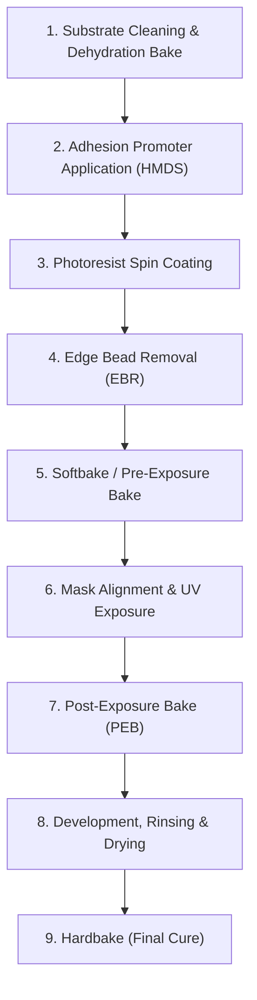

# Topic E: Photolithography
**Course**: Microsystems Technologies and Processes (University of Freiburg)  
**Sources**: *Lecture Slides: Photolithography part 1 & part 2*; *Derivation of the spin-coating equation*; *Derivation of the diffraction equation*; *Rapp (2017)*

---

## Part 1: Photomask Fundamentals & Substrate Materials

### Question 1.1: Light Modulation Parameters & Photomask Types
* **Question**: *Which two physical properties of incoming light can be modulated by a photomask? Name two distinct mask types.*  
* **Exam Appearances**: *WS 2019/2020 (Q4.1), WS 2022/2023 (Q5.4–5.5), WS 2023/2024 (Q4.4–4.5), SS 2024 (Q5.4–5.5), WS 2024/2025 (Q5.5), SS 2025 (Q4.3)*

#### Solution:
1. **The Two Light Modulation Parameters**:
   * **Amplitude (Intensity)**: Modulated by opaque absorber patterns (e.g., Chromium metal features) blocking or transmitting light rays.
   * **Phase**: Modulated by varying substrate thickness or transparent phase-shifting layers to introduce destructive interference ($\\pi$ phase shift) at feature edges.

2. **Distinct Photomask Types**:
   * **Binary Chromium-on-Glass (COG) Mask**: Standard optical mask consisting of an opaque patterned Chromium layer deposited on a transparent quartz or glass substrate.
   * **Phase-Shift Mask (PSM)**: Advanced mask incorporating etched glass or phase-shifting material to modulate light phase for enhanced edge contrast.
   * **Digital Micromirror Device (DMD) / Maskless Spatial Light Modulator**: Dynamic reflective micro-mirror array used in direct-write lithography.

---

### Question 1.2: Photomask Substrate Selection & Run-Out Limits
* **Question**: *What are the three most common transparent glass substrate types for photomasks? Which substrate would you select for UV lithography at a wavelength of 200 nm, and why?*  
* **Exam Appearances**: *WS 2019/2020 (Q4.3), WS 2022/2023 (Q5.8), SS 2023 (Q5.8), SS 2024 (Q5.8)*

#### Solution:
1. **Three Common Glass Substrate Types**:
   * **Soda-Lime Glass (Natron/Green Glass)**: High Temperature Expansion (HTE) glass ($\\alpha \approx 9.5\text{ ppm}/^\circ\text{C}$).
   * **Borosilicate Glass (White Crown Glass)**: Low Temperature Expansion (LTE) glass ($\\alpha \approx 3.5\text{ ppm}/^\circ\text{C}$).
   * **Quartz Glass (Fused Silica) / Fluoride Glass**: Ultra-Low Temperature Expansion (ULTE) material ($\\alpha \approx 0.5\text{ ppm}/^\circ\text{C}$).

2. **Selection for 200 nm Deep-UV Lithography**:
   * **Selected Substrate**: **Quartz / Fused Silica Glass**.
   * **Physical Justification**:
     1. **UV Transparency**: Standard window glass, soda-lime, and borosilicate glasses absorb ultraviolet light strongly at wavelengths $\\lambda < 300\text{ nm}$, whereas quartz exhibits high optical transmittance down to $193\text{ nm}$.
     2. **Minimal Thermal Run-Out**: Quartz possesses an extremely low thermal expansion coefficient ($\\alpha = 0.5\text{ ppm}/^\circ\text{C}$), preventing mask expansion and pattern run-out errors under thermal load during high-intensity UV exposure.

---

### Question 1.3: Anti-Reflective Coatings (ARC / BARC) & Standing Waves
* **Question**: *Why is an Anti-Reflective Coating (ARC) used beneath the Chromium mask or photoresist? Derive the optimal thickness equation $d = \frac{\lambda}{4 n_{\text{coating}}}$ for normal incidence.*  
* **Exam Appearances**: *Theoretical question based on lecture fundamentals*

#### Solution:
1. **Purpose of ARC**:
   * Monochromatic UV light used in photolithography reflects off metallic or silicon substrates and interferes with incoming exposure light, forming **standing waves** within the photoresist film.
   * Standing waves create periodic vertical step variations along resist sidewalls. An Anti-Reflective Coating (ARC / BARC) eliminates back-reflection, smoothing sidewall profiles.

2. **Derivation of Optimal Film Thickness**:
   * From thin-layer interferometry, the optical path length difference $\\Delta l$ between surface-reflected and bottom-reflected light at angle $\\beta$ is:
     $$\\Delta l = 2 d \cdot n_{\text{coating}} \cos \beta$$
   * For normal/perpendicular incidence ($\\beta = 0^\circ \implies \cos \beta = 1$):
     $$\\Delta l = 2 d \cdot n_{\text{coating}}$$
   * For complete destructive (negative) interference, the reflected wave must be out of phase by a half wavelength ($\\Delta l = \frac{\lambda}{2}$, corresponding to a phase shift of $\\pi$):
     $$2 d \cdot n_{\text{coating}} = \frac{\lambda}{2} \implies d = \frac{\lambda}{4 n_{\text{coating}}}$$
   * Hence, ARCs are known as **$\lambda / 4$ coatings**.

---

## Part 2: Optical Lithography Exposure Systems & Resolution Limits

### Question 2.1: Comparison of Optical Lithography Setups
* **Question**: *Sketch and compare the three distinct optical lithography exposure setups. State the minimum achievable feature resolution equation for each.*  
* **Exam Appearances**: *WS 2018/2019 (Q4.7), SS 2019 (Q4.7), WS 2019/2020 (Q4.2), WS 2022/2023 (Q5.6), SS 2023 (Q5.6), SS 2024 (Q5.6), WS 2024/2025 (Q5.6), SS 2025 (Q4.1)*

#### Solution:



```mermaid
graph TD
    subgraph 1_Contact_Lithography
        C_Light["UV Light Source"] --> C_Mask["Photomask"]
        C_Mask --> C_Resist["Photoresist (Direct Physical Contact)"]
        C_Resist --> C_Substrate["Substrate"]
    end
    subgraph 2_Proximity_Lithography
        P_Light["UV Light Source"] --> P_Mask["Photomask"]
        P_Mask -- "Air Gap g (10-50 µm)" --> P_Resist["Photoresist"]
        P_Resist --> P_Substrate["Substrate"]
    end
    subgraph 3_Projection_Lithography
        PR_Light["Light Source & Condenser"] --> PR_Mask["Photomask"]
        PR_Mask --> PR_Lens["Projection Reduction Optics (NA)"]
        PR_Lens --> PR_Resist["Photoresist"]
        PR_Resist --> PR_Substrate["Substrate"]
    end
```

| Lithography Setup | Physical Configuration | Minimum Feature Resolution Equation | Source Citation |
| :--- | :--- | :--- | :--- |
| **Contact Lithography** | Photomask is clamped in direct physical contact with the photoresist surface. | $$W_{\text{min}} \approx \sqrt{\lambda \cdot d_{\text{resist}}}$$ | *Lecture Slides: Photolithography part 1* |
| **Proximity Lithography** | Photomask is separated from photoresist by a small physical air gap $g$ ($\\sim 10\text{--}50\,\mu\text{m}$). | $$W_{\text{min}} \approx \sqrt{\lambda \cdot g}$$ | *Lecture Slides: Photolithography part 1* |
| **Projection Lithography** | Projection reduction lens system projects demagnified image of the mask onto resist. | Rayleigh Criterion: $$R = k_1 \frac{\lambda}{\text{NA}} = k_1 \frac{\lambda}{n \sin \alpha}$$ | *Lecture Slides: Photolithography part 1 & part 2* |

* **Diagram References**:
  > **Source Location**: *Lecture Slides: MST Technologies and Processes, Photolithography, part 1.pdf*, slides titled **"Contact lithography"**, **"Proximity lithography"**, and **"Projection lithography"**.

---

### Question 2.2: Diffraction Regimes & Stepper Projection Errors
* **Question**: *Explain the transition between Fresnel and Fraunhofer diffraction regimes in proximity lithography. List four common projection errors encountered in wafer steppers.*  
* **Exam Appearances**: *WS 2019/2020 (Q4.4), WS 2024/2025 (Q5.7), SS 2025 (Q4.1)*

#### Solution:
1. **Diffraction Regimes**:
   * **Near-field (Fresnel Diffraction)**: Occurs when mask-to-wafer gap $g < \frac{d_{\text{min}}^2}{\lambda}$, producing complex intensity fringes near feature edges.
   * **Far-field (Fraunhofer Diffraction)**: Occurs when gap $g > \frac{d_{\text{min}}^2}{\lambda}$, forming the characteristic Airy disc diffraction pattern.

2. **Four Common Stepper Projection Errors**:
   * **Translation Error**: Lateral spatial offset ($\\Delta x, \\Delta y$) between mask projection and substrate features.
   * **Rotation Error**: Angular misalignment ($\\Delta \theta$) of projected mask patterns relative to wafer axes.
   * **Magnification Error**: Projected image size is slightly larger or smaller than target due to incorrect lens spacing or thermal expansion.
   * **Tilt Error**: Non-parallelism between mask and wafer planes causing trapezoidal distortion across the exposure field.
   * **Lens Distortion**: Optical aberration causing straight lines to project with curvature.

---

## Part 3: Photoresist Chemistry, Contrast Curves & Processing Steps

### Question 3.1: Positive vs. Negative Photoresists
* **Question**: *Define positive and negative photoresists. Give one example of each and state their developer chemistry.*  
* **Exam Appearances**: *SS 2019 (Q4.8), SS 2023 (Q5.7), SS 2024 (Q5.7), WS 2024/2025 (Q5.7)*

#### Solution:
1. **Positive Photoresist**:
   * **Definition**: UV exposure breaks chemical bonds or protection groups, making exposed regions **more soluble** in developer solution.
   * **Resist Example**: Novolak/DNQ (e.g., AZ photoresists) or t-BOC poly(vinylphenol) chemically amplified resist.
   * **Developer Solution**: Aqueous basic solutions (e.g., $\text{NaOH}$, $\text{KOH}$, or Tetramethylammonium hydroxide TMAH).

2. **Negative Photoresist**:
   * **Definition**: UV exposure induces crosslinking or polymerization, making exposed regions **insoluble / less soluble** in developer solution.
   * **Resist Example**: SU-8 epoxy resin or bisazide/rubber resists.
   * **Developer Solution**: Organic solvents (e.g., PGMEA - propylene glycol monomethyl ether acetate).

---

### Question 3.2: Contrast Curve Parameters ($D_0, D_{100}, \gamma$)
* **Question**: *Sketch a typical photoresist characteristic contrast curve. Define $D_0$, $D_{100}$, and state the equation for resist contrast $\gamma$.*  
* **Exam Appearances**: *WS 2022/2023 (Q5.7), WS 2023/2024 (Q4.7), SS 2024 (Q5.7), WS 2024/2025 (Q5.7)*

#### Solution:

```
Positive Resist Contrast Curve:            Negative Resist Contrast Curve:
Normalized Thickness                       Normalized Thickness
   1 |--------\                               1 |             /-------
     |         \                                |            /
     |          \                               |           /
   0 +-----------+-----> Log(Dose)            0 +----------+---------> Log(Dose)
                D0   D100                                 D0   D100
```

1. **Parameter Definitions**:
   * **$D_0$ (Incipient Dose)**: Minimum exposure dose required to begin altering resist solubility.
   * **$D_{100}$ (Completion Dose)**: Exposure dose at which the resist is completely developed (fully removed for positive resist, fully crosslinked/retained for negative resist).

2. **Resist Contrast Equation**:
   $$\gamma = \frac{1}{\log_{10}\left(\frac{D_{100}}{D_0}\right)}$$
   * **Significance**: Higher contrast $\gamma$ yields steeper profile slopes and sharper edge resolution. Typical i-line resists exhibit $\gamma \approx 2\text{--}3$.

---

### Question 3.3: Post-Exposure Bake (PEB) & Photolithography Workflow
* **Question**: *What is the physical reason for performing a Post-Exposure Bake (PEB)? Sketch the complete classical photolithography process workflow.*  
* **Exam Appearances**: *SS 2023 (Q5.9), SS 2024 (Q5.9), WS 2024/2025 (Q5.4, Q5.8), SS 2025 (Q4.2)*

#### Solution:
1. **Purpose of Post-Exposure Bake (PEB)**:
   * Accelerates thermally-driven chemical reactions (such as catalytic ester cleavage in chemically amplified resins).
   * Promotes photoactive compound diffusion to smooth out vertical standing wave ripples along sidewalls.
   * Evaporates volatile reaction by-products prior to wet development.

2. **Complete Photolithography Workflow Sequence**:



* **Diagram References**:
  > **Source Location**: *Lecture Slides: MST Technologies and Processes, Photolithography, part 2.pdf*, slide titled **"The basic lithography workflow"**.

---

## Part 4: Analytical Derivation of the Spin-Coating Equation

### Question 4.1: Mathematical Derivation of Spin-Coated Film Thickness $h(t)$
* **Question**: *Derive the general spin-coating equation $h(t) = \frac{h_0}{\sqrt{1 + 4 K h_0^2 t}}$ starting from Navier-Stokes momentum balance and continuity equations (Emslie et al. model). Show that high spin speeds yield $h(t) \propto \frac{\sqrt{\eta}}{\omega \sqrt{t}}$.*  
* **Exam Appearances**: *Theoretical derivation based on Excursus slides*

#### Step-by-Step Analytical Derivation:

1. **Governing Force Balance & Navier-Stokes Equation**:
   Consider an infinitesimal volume element of photoresist of density $\\rho$ and viscosity $\\eta$ on a spinning wafer rotating at angular velocity $\\omega$.
   The primary volume driving force acting radially outward is the centrifugal force per unit volume:
   $$k_r = \rho r \omega^2$$
   Assuming steady, fully-developed, laminar flow of an incompressible Newtonian fluid, the Navier-Stokes momentum equation in cylindrical coordinates simplifies to a 1D ordinary differential equation:
   $$\\eta \frac{d^2 v_r}{dz^2} = -\rho r \omega^2$$

2. **Boundary Conditions & Radial Velocity Profile**:
   * No-slip condition at wafer surface ($z = 0$): $v_r(0) = 0$.
   * Free-surface shear-stress condition at top of resist film ($z = h$): $\\left.\frac{d v_r}{dz}\right|_{z=h} = 0$.

   Integrating twice with respect to $z$:
   $$\\frac{d v_r}{dz} = -\frac{\rho r \omega^2}{\eta} z + C_1 \implies C_1 = \frac{\rho r \omega^2}{\eta} h$$
   $$v_r(z) = -\frac{\rho r \omega^2}{\eta} \frac{z^2}{2} + \frac{\rho r \omega^2 h}{\eta} z + C_2 \implies C_2 = 0$$
   $$v_r(z) = \frac{\rho r \omega^2}{\eta} \left( z h - \frac{z^2}{2} \right)$$

3. **Specific Radial Volume Flow Rate $\dot{q}$**:
   Integrating radial velocity $v_r(z)$ across film height $h$:
   $$\dot{q} = \int_0^h v_r(z) dz = \frac{\rho r \omega^2}{\eta} \left[ \frac{z^2 h}{2} - \frac{z^3}{6} \right]_0^h = \frac{\rho r \omega^2 h^3}{3 \eta}$$

4. **Mass Continuity & Time-Dependent Height Change**:
   The rate of film thinning $\frac{\partial h}{\partial t}$ is governed by the conservation of mass (continuity equation) in cylindrical coordinates:
   $$\frac{\partial h}{\partial t} = -\frac{1}{r} \frac{\partial}{\partial r} (r \dot{q})$$
   Substituting $\dot{q} = \frac{\rho r \omega^2 h^3}{3 \eta} = K r h^3$, where $K \equiv \frac{\rho \omega^2}{3 \eta}$:
   $$\frac{\partial h}{\partial t} = -\frac{1}{r} \frac{\partial}{\partial r} \left( K r^2 h^3 \right) = -\frac{1}{r} \left( 2 K r h^3 + K r^2 \frac{\partial (h^3)}{\partial r} \right)$$
   Assuming a radially uniform film ($\frac{\partial h}{\partial r} = 0$), this simplifies to an ordinary differential equation:
   $$\frac{dh}{dt} = -2 K h^3$$

5. **Integration for Film Thickness $h(t)$**:
   Separating variables and integrating from initial thickness $h_0$ at $t = 0$:
   $$\int_{h_0}^h h^{-3} dh = -2 K \int_0^t dt$$
   $$\left[ -\frac{1}{2 h^2} \right]_{h_0}^h = -2 K t \implies \frac{1}{h^2} - \frac{1}{h_0^2} = 4 K t$$
   $$\frac{1}{h^2} = \frac{1 + 4 K h_0^2 t}{h_0^2} \implies h(t) = \frac{h_0}{\sqrt{1 + 4 K h_0^2 t}}$$

6. **High Spin-Speed / Long Time Approximation**:
   For typical processing conditions with high spin speeds $\\omega$ ($4 K h_0^2 t \gg 1$):
   $$h(t) \approx \frac{h_0}{\sqrt{4 K h_0^2 t}} = \frac{1}{\sqrt{4 K t}} = \frac{1}{\sqrt{4 \cdot \left(\frac{\rho \omega^2}{3 \eta}\right) t}} = \sqrt{\frac{3 \eta}{4 \rho \omega^2 t}}$$
   * **Proportionality**: Final film thickness scales as $h \propto \frac{\sqrt{\eta}}{\omega \sqrt{t}}$, confirming that rotational spin speed $\\omega$ is the primary parameter controlling resist thickness.
