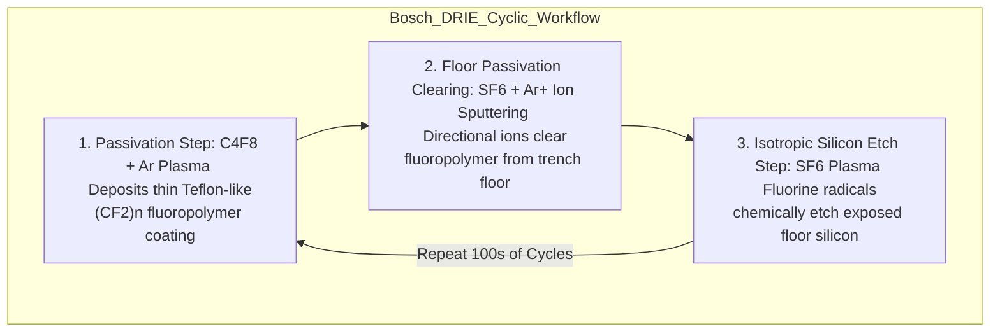

# Topic F: Etching Technologies
**Course**: Microsystems Technologies and Processes (University of Freiburg)  
**Sources**: *Lecture Slides: Etching.pdf*; *Rapp (2017)*; *WO1994014187A1 Bosch Patent*; *Tachi et al. (1987)*; *Shaw et al. (1994)*; *Zhang & McDonald (1992)*

---

## Part 1: Fundamentals of Etching & Anisotropy Factor

### Question 1.1: Anisotropy Factor Definition & Classification
* **Question**: *Define the anisotropy factor $A$. State the numerical values of $A$ for isotropic and perfectly anisotropic etching and give one physical example of each.*
* **Exam Appearances**: *WS 2018/2019 (Q5.1), SS 2019 (Q5.1), SS 2022 (Q5.1)*

#### Solution:
1. **Anisotropy Factor Equation**:
   The anisotropy factor $A$ quantifies the directional selectivity of an etching process and is defined as:
   $$A = 1 - \frac{R_{\text{lateral}}}{R_{\text{vertical}}}$$
   where $R_{\text{lateral}}$ is the lateral etch rate (or lateral undercut length in $\mu\text{m}$) and $R_{\text{vertical}}$ is the vertical etch rate (or etch depth in $\mu\text{m}$).

2. **Limiting Cases & Examples**:
   * **Isotropic Etching ($A = 0$)**:
     * $R_{\text{lateral}} = R_{\text{vertical}}$. Material is removed equally in all spatial directions, resulting in rounded, spherical topologies.
     * **Example**: Wet chemical etching of glass using hydrofluoric acid ($\text{HF}$), or isotropic wet etching of silicon in $\text{HF}/\text{HNO}_3$ mixtures.
   * **Perfectly Anisotropic Etching ($A = 1$)**:
     * $R_{\text{lateral}} = 0$. Material is removed exclusively in one fixed direction (unidirectional), forming vertical, straight-walled trenches.
     * **Example**: Deep Reactive Ion Etching (DRIE / Bosch process) of silicon, or anisotropic wet etching of (110) silicon in $\text{KOH}$.

---

## Part 2: Metal Electrode Patterning Workflows (Lift-Off vs. Metal Etch)

### Question 2.1: Metallic Electrode Fabrication Workflows
* **Question**: *Sketch and explain two workflows for generating a metallic electrode structure (e.g., made from Gold). One of these processes requires a metal etch step, while the other does not.*
* **Exam Appearances**: *WS 2018/2019 (Q5.1), SS 2019 (Q5.1), SS 2020 (Q5.1)*

#### Solution:



```mermaid
graph TD
    subgraph Workflow_1_Subtractive_Metal_Etch
        A1["1. Clean Substrate"] --> A2["2. Full-Surface Metal Deposition (Sputter Au)"]
        A2 --> A3["3. Spin-Coat Positive Photoresist"]
        A3 --> A4["4. Mask Exposure & Development (Resist covers electrodes)"]
        A4 --> A5["5. Chemical Metal Etch (e.g. Aqua Regia / KI+I2)"]
        A5 --> A6["6. Strip Photoresist -> Gold Electrodes Remain"]
    end
    subgraph Workflow_2_Additive_Lift_Off_No_Metal_Etch
        B1["1. Clean Substrate"] --> B2["2. Spin-Coat Photoresist"]
        B2 --> B3["3. Mask Exposure & Development (Inverted Pattern / Undercut)"]
        B3 --> B4["4. Full-Surface Metal Deposition (Evaporate/Sputter Au)"]
        B4 --> B5["5. Solvent Lift-Off in Acetone (Dissolves resist & lifts over-metal)"]
        B5 --> B6["6. Direct Gold Electrodes Remain"]
    end
```

1. **Workflow 1: Subtractive Process (Requires Metal Etch)**:
   * **Step 1**: Deposit a continuous thin metal layer (e.g., Titanium adhesion layer + Gold $\text{Au}$, $\\sim 100\text{--}200\text{ nm}$) over the entire substrate surface via sputtering or evaporation.
   * **Step 2**: Spin-coat a layer of photoresist over the metallized wafer and perform softbake.
   * **Step 3**: Align the photomask (electrode pattern), expose to UV light, and develop. Photoresist remains directly on top of the intended electrode areas.
   * **Step 4**: Perform chemical wet metal etching (e.g., using $\text{KI}/\text{I}_2$ iodine etchant or aqua regia for Gold) to remove unmasked metal regions.
   * **Step 5**: Strip the protective photoresist in an organic solvent or oxygen plasma, leaving the patterned gold electrodes.

2. **Workflow 2: Additive Process / Lift-Off (No Metal Etch Required)**:
   * **Step 1**: Spin-coat photoresist directly onto the bare, clean substrate.
   * **Step 2**: Perform photolithography using an inverted electrode mask (exposing areas where metal should *not* be present) and develop to create negative resist sidewall profiles.
   * **Step 3**: Deposit the Gold ($\text{Au}$) thin film line-of-sight across the entire patterned wafer (via e-beam evaporation or sputtering). Metal lands on both the exposed substrate and the top of the photoresist features.
   * **Step 4**: Immerse the wafer in a solvent bath (e.g., acetone or NMP) with ultrasonic agitation. The solvent penetrates and dissolves the underlying photoresist, lifting off the overlying metal film. Metal remains only where it was deposited directly onto the substrate.

---

## Part 3: Isotropic Wet Etching of Silicon & Glass (HNA System & Ternary Diagrams)

### Question 3.1: Reaction Equation for Silicon Wet Etching in $\text{HF}/\text{HNO}_3$
* **Question**: *State the chemical wet etching reaction equation of silicon in a mixture of Nitric Acid ($\text{HNO}_3$) and Hydrofluoric Acid ($\text{HF}$).*
* **Exam Appearances**: *SS 2019 (Q5.2), SS 2020 (Q5.2), SS 2022 (Q5.5)*

#### Solution:
The overall chemical redox reaction for the isotropic wet etching of silicon in an $\text{HNA}$ ($\text{HF} / \text{HNO}_3 / \text{Diluent}$) mixture is:
$$3\text{Si} + 4\text{HNO}_3 + 18\text{HF} \rightarrow 3\text{H}_2\text{SiF}_6 + 4\text{NO}\uparrow + 8\text{H}_2\text{O}$$

* **Reaction Mechanism**:
  1. **Oxidation**: Nitric acid ($\text{HNO}_3$) acts as a strong oxidizing agent, converting elemental surface silicon into silicon dioxide:
     $$\text{3Si} + 4\text{HNO}_3 \rightarrow 3\text{SiO}_2 + 4\text{NO}\uparrow + 2\text{H}_2\text{O}$$
  2. **Dissolution**: Hydrofluoric acid ($\text{HF}$) reacts with the newly formed silicon dioxide layer to yield soluble fluorosilicic acid ($\text{H}_2\text{SiF}_6$):
     $$\text{SiO}_2 + 6\text{HF} \rightarrow \text{H}_2\text{SiF}_6 + 2\text{H}_2\text{O}$$

---

### Question 3.2: Reading Ternary Phase Diagrams for $\text{HNA}$ Etching Solutions
* **Question**: *Given the ternary etching diagram for $\text{HF}\text{--}\text{HNO}_3\text{--}\text{Acetic Acid}$, state three etching solution compositions that yield an etch rate of $13\ \mu\text{m/min}$ (or $6\ \mu\text{m/min}$). State which mixture composition is preferred and why.*
* **Exam Appearances**: *SS 2019 (Q5.6–5.7), SS 2020 (Q5.3), WS 2023/2024 (Q5.1), SS 2025 (Q5.6–5.7)*

#### Solution:

```
                  HF (49.23%)
                     / \
                    /   \
                   /  *  \  <- Iso-etch rate contour line
                  /       \
                 /_________\
  Diluent (AcOH)             HNO3 (69.51%)
```

1. **Reading Compositions for $13\ \mu\text{m/min}$ Etch Rate** (from *Exam SS 2020 Q5.3* & *Lecture Slides: Etching.pdf* slide "Example: designing an etching solution"):
   By locating the $13\ \mu\text{m/min}$ solid iso-etch rate contour line on the ternary phase diagram, three valid mixture compositions (in weight percentages of commercial reagents) are:
   * **Composition A**: $20\text{ wt\% } \text{HNO}_3\ (69.51\%) + 60\text{ wt\% } \text{HF}\ (49.23\%) + 20\text{ wt\% } \text{Diluent (Acetic Acid } \text{HC}_2\text{H}_3\text{O}_2)$.
   * **Composition B**: $30\text{ wt\% } \text{HNO}_3 + 50\text{ wt\% } \text{HF} + 20\text{ wt\% } \text{Diluent}$.
   * **Composition C**: $15\text{ wt\% } \text{HNO}_3 + 65\text{ wt\% } \text{HF} + 20\text{ wt\% } \text{Diluent}$.

2. **Reading Compositions for $6\ \mu\text{m/min}$ Etch Rate** (from *Exam SS 2019 Q5.6* & *WS 2023/2024 Q5.1*):
   Along the $6\ \mu\text{m/min}$ solid iso-etch rate contour line:
   * **Composition 1**: $25\text{ wt\% } \text{HNO}_3 + 35\text{ wt\% } \text{HF} + 40\text{ wt\% } \text{Acetic Acid}$.
   * **Composition 2**: $40\text{ wt\% } \text{HNO}_3 + 20\text{ wt\% } \text{HF} + 40\text{ wt\% } \text{Acetic Acid}$.
   * **Composition 3**: $50\text{ wt\% } \text{HNO}_3 + 15\text{ wt\% } \text{HF} + 35\text{ wt\% } \text{Acetic Acid}$.

3. **Preference Justification**:
   * **Preferred Region**: The **$\text{HNO}_3$-rich / $\text{HF}$-limited region** (lower right side of the ternary plot) is preferred.
   * **Physical Explanation**: In the $\text{HF}$-limited regime, oxidation by excess $\text{HNO}_3$ occurs rapidly, making the dissolution rate of $\text{SiO}_2$ by $\text{HF}$ the rate-limiting step. This diffusion-controlled regime yields smooth, polished, mirror-like silicon surfaces, whereas $\text{HF}$-rich mixtures are reaction-rate limited and result in rough, pitted surface topographies.
* **Diagram Reference**:
  > **Source Location**: *Lecture Slides: Etching.pdf*, slide titled **"Example: designing an etching solution"** (showing the ternary phase diagram of $\text{HF}(49.23\%)\text{--}\text{HNO}_3(69.51\%)\text{--}\text{Diluent}$ with iso-etch rate contours).

---

## Part 4: Anisotropic Wet Etching of Silicon (KOH, TMAH, EDP)

### Question 4.1: Anisotropic Alkaline Etchants & General Reaction
* **Question**: *Name two to three typical alkaline etchants used for anisotropic silicon etching. Write down the universal chemical reaction equation for anisotropic silicon wet etching.*
* **Exam Appearances**: *WS 2021/2022 (Q5.2), WS 2023/2024 (Q5.2), SS 2025 (Q5.2)*

#### Solution:
1. **Three Typical Alkaline Etchants**:
   * **Potassium Hydroxide ($\text{KOH}$)**.
   * **Tetramethylammonium Hydroxide ($\text{TMAH}$)**.
   * **Ethylenediamine Pyrocatechol ($\text{EDP}$)**.

2. **Universal Chemical Reaction Equation**:
   All alkaline silicon etchants share the same fundamental oxidation-reduction mechanism:
   $$\text{Si} + 2\text{X}^+ + \text{OH}^- + \text{H}_2\text{O} \rightarrow \text{X}_2\text{SiO}_3 + 2\text{H}_2\uparrow$$
   * For Potassium Hydroxide ($\\text{X} = \text{K}$), the reaction yields potassium silicate salt and hydrogen gas:
     $$\text{Si} + 2\text{K}^+ + 2\text{OH}^- + \text{H}_2\text{O} \rightarrow \text{K}_2\text{SiO}_3 + 2\text{H}_2\uparrow$$

---

### Question 4.2: Crystallographic Dependence & Etch Stop Planes
* **Question**: *Why do $\{111\}$ crystal planes act as etch stop planes during anisotropic wet etching of silicon? What characteristic angle is formed between the (100) surface plane and the {111} sidewalls?*
* **Exam Appearances**: *WS 2018/2019 (Q5.3), SS 2021 (Q5.3), WS 2024/2025 (Q5.3)*

#### Solution:
1. **Physical Cause for $\{111\}$ Etch Stop**:
   * **Atomic Density & Bonding**: Atoms lying on the $\{111\}$ plane possess three back-bonds directed into the bulk crystal lattice and only one dangling bond pointing toward the etchant solution.
   * **Atomic Packing**: The $\{111\}$ planes form extremely crowded atomic layers separated by sparsely occupied bands. Because hydroxide ions ($\text{OH}^-$) cannot easily break three sterically hindered back-bonds simultaneously, the etch rate of $\{111\}$ planes is **30 to 400 times slower** than that of $\{100\}$ or $\{110\}$ planes. Consequently, etching halts at $\{111\}$ plane boundaries.

2. **Characteristic Angle**:
   * The angle between the $\{100\}$ wafer surface plane and the bounding $\{111\}$ sidewall plane is **$54.74^\circ$**.

---

### Question 4.3: Etchant Selection on (110) Silicon Wafers (TMAH vs. KOH)
* **Question**: *You are shown cross-sectional images of deep grooves etched into a (110) silicon wafer using alkaline etchants. One etchant preserves flat, vertical sidewalls while another creates bottom corner faceting. Which etchant was used in each case?*
* **Exam Appearances**: *WS 2021/2022 (Q5.3), WS 2023/2024 (Q5.3)*

#### Solution:
* **Left Image (Smooth Vertical Sidewalls, No Bottom Faceting)**: Etched using **$\text{TMAH}$** ($25\% \text{ TMAH at } 86^\circ\text{C}$). $\text{TMAH}$ exhibits a lower $\{100\}/\{111\}$ selectivity ratio ($\\sim 30:1$), which prevents aggressive corner-undercutting faceting on (110) substrates.
* **Right Image (Visible $\{111\}$ Planes at Trench Bottom)**: Etched using **$\text{KOH}$** ($40\% \text{ KOH at } 70^\circ\text{C}$). $\text{KOH}$ possesses an extremely high anisotropy ratio ($\\sim 400:1$), causing rapid development of bounding $\{111\}$ planes at trench bases.
* **Diagram Reference**:
  > **Source Location**: *Lecture Slides: Etching.pdf*, slide titled **"Isotropic vs. anisotropic"**, Figure 9 ("Actual etch profiles of a deep groove etched on a (110) wafer using TMAH and KOH").

---

### Question 4.4: Property Comparison of Anisotropic Etchants ($\\text{KOH}, \\text{TMAH}, \\text{EDP}$)
* **Question**: *Compare $\text{KOH}$, $\text{TMAH}$, and $\text{EDP}$ in terms of anisotropy ratio, etch mask selectivity, toxicity, and IC cleanroom compatibility.*

#### Solution:

| Feature | Potassium Hydroxide ($\text{KOH}$) | Tetramethylammonium Hydroxide ($\text{TMAH}$) | Ethylenediamine Pyrocatechol ($\text{EDP}$) | Source Citation |
| :--- | :--- | :--- | :--- | :--- |
| **Anisotropy Ratio $(\{100\}/\{111\})$** | **Highest ($\\sim 400:1$)** | Moderate ($\\sim 30:1$) | High ($\\sim 35:1$) | *Lecture Slides: Etching.pdf* |
| **Silicon Etch Rate ($\{110\}$)** | $1.4\ \mu\text{m/min}$ | $1.0\ \mu\text{m/min}$ | $1.25\ \mu\text{m/min}$ | *Lecture Slides: Etching.pdf* |
| **Etch Mask Selectivity** | Excellent for $\text{Si}_3\text{N}_4$; good for $\text{SiO}_2$ ($400:1$) | Excellent for $\text{Si}_3\text{N}_4$; attacks $\text{SiO}_2$ slowly | Outstanding for $\text{Si}_3\text{N}_4$, $\text{SiO}_2$ ($5000:1$), and metals ($\text{Au}, \text{Cr}$) | *Lecture Slides: Etching.pdf* |
| **Toxicity & Handling** | **Non-toxic**; easy handling | **Toxic**; strong organ base | **Highly toxic & carcinogenic**; ages rapidly in air | *Lecture Slides: Etching.pdf* |
| **IC / CMOS Compatibility** | **Poor** (alkali $\text{K}^+$ ions cause mobile charge gate contamination; corrodes $\text{Al}$) | **Excellent** (alkali-ion-free metal-ion-free developer) | Good (metal-ion-free, preserves $\text{Al}$ if doped) | *Lecture Slides: Etching.pdf* |

---

## Part 5: Dry Etching Technologies (Plasma, Sputter, RIE)

### Question 5.1: Comparison of Core Dry Etching Modes
* **Question**: *Sketch and explain the operating principles of (a) Plasma Etching (PE), (b) Sputter Etching (SE), and (c) Reactive Ion Etching (RIE). Compare them regarding mechanism, anisotropy, and selectivity.*
* **Exam Appearances**: *WS 2018/2019 (Q5.2–5.4), SS 2019 (Q5.3–5.5)*

#### Solution:

```
a) Plasma Etching (PE)         b) Sputter Etching (SE)        c) Reactive Ion Etching (RIE)
   (Chemical / Isotropic)         (Physical / Anisotropic)       (Hybrid Chemical-Physical)
      [ Radicals F* ]                [ Ar+ Ions ]                  [ Ar+ Ions & F* Radicals ]
         |   |   |                      |   |   |                      |   |   |
      vvvvvvvvvvvvv                  vvvvvvvvvvvvv                  vvvvvvvvvvvvv
     +---------------+              +---------------+              +---------------+
     |   Substrate   |              |   Substrate   |              |   Substrate   |
     +---------------+              +---------------+              +---------------+
```

1. **Plasma Etching (PE / Chemical Dry Etching)**:
   * **Mechanism**: Glow discharge plasma dissociates precursor gas molecules (e.g., $\text{CF}_4 / \text{O}_2$ or $\text{SF}_6$) into uncharged, highly reactive free radicals ($\text{F}^*$). Radicals diffuse to the substrate surface, adsorb, and react chemically to form volatile reaction products (e.g., $\text{SiF}_4\uparrow$) that are pumped away.
   * **Anisotropy**: **Isotropic ($A \approx 0$)**.
   * **Selectivity**: **Very High**.

2. **Sputter Etching (SE / Physical Dry Etching)**:
   * **Mechanism**: Inert gas ions ($\text{Ar}^+$) generated in a low-pressure plasma are accelerated directionally by a high DC/RF electric field toward the negatively biased substrate. Physical momentum transfer knocks out surface atoms (ion milling / sputtering).
   * **Anisotropy**: **High ($A \approx 1$)**.
   * **Selectivity**: **Low** (sputters substrate, mask, and underlying layers at comparable rates). Redeposition of sputtered non-volatile species can occur on sidewalls.

3. **Reactive Ion Etching (RIE / Hybrid Process)**:
   * **Mechanism**: Synergistic combination of chemical and physical etching. Reactive fluorine radicals ($\text{F}^*$) chemically attack silicon, while energetic ion bombardment ($\text{Ar}^+$) weakens surface chemical bonds and desorbs non-volatile reaction products from horizontal floors.
   * **Rate Enhancement**: The combined etch rate of RIE is **an order of magnitude faster** than the sum of pure chemical plasma etching and pure physical sputter etching acting independently.
   * **Anisotropy**: **High** (aspect ratios up to 20--30).
   * **Selectivity**: **Moderate to High**.
* **Diagram Reference**:
  > **Source Location**: *Lecture Slides: Etching.pdf*, slide titled **"Dry etching processes: physical + chemical etching"**, Figure ("sputtering, sputter etching, inverse sputter etching, reactive ion etching").

---

## Part 6: Deep Reactive Ion Etching (DRIE: Bosch vs. Cryogenic Process)

### Question 6.1: The Bosch DRIE Process Workflow & Reactions
* **Question**: *Sketch and describe the process steps of the Bosch process. State the chemical plasma gases used and write down the actual etching reaction of silicon. Explain why Bosch-etched sidewalls exhibit a characteristic wavy / scalloped profile.*
* **Exam Appearances**: *WS 2021/2022 (Q5.4), WS 2023/2024 (Q5.4), WS 2024/2025 (Q5.4)*

#### Solution:



1. **Process Workflow**:
   The Bosch process (invented by A. Urban and F. Lärmer at Robert Bosch GmbH in 1994) achieves deep, vertical silicon structures by rapidly alternating between two distinct operational modes in a time-multiplexed ICP-RIE system:

   * **Step 1: Passivation Cycle**:
     * **Gas Feed**: Octafluorocyclobutane ($\text{C}_4\text{F}_8$) mixed with Argon ($\text{Ar}$).
     * **Action**: Plasma glow discharge generates $(\text{CF}_x)_n$ fluoropolymer radicals that deposit an ultra-thin, conformal, Teflon-like protective coating across the top mask, sidewalls, and trench floor.

   * **Step 2: Anisotropic Floor Clearing & Chemical Etch Cycle**:
     * **Gas Feed**: Sulfur Hexafluoride ($\text{SF}_6$) in Argon ($\text{Ar}$).
     * **Physical Action**: Directional $\text{Ar}^+$ ions accelerated by the substrate bias strike horizontal surfaces, selectively sputtering away the thin $(\text{CF}_x)_n$ passivation film from the trench floor while leaving vertical sidewall passivation intact.
     * **Chemical Action**: Fluorine radicals ($\text{F}^*$) generated from $\text{SF}_6$ chemically react with exposed floor silicon to etch isotropic micro-cavities:
       $$\text{SF}_6 + e^- \rightarrow \text{SF}_5^+ + \text{F}^* + 2e^-$$
       $$\text{Si} + 4\text{F}^* \rightarrow \text{SiF}_4\uparrow \text{ (Volatile gas)}$$

2. **Cause of Sidewall Scalloping (Waviness)**:
   * Because the chemical $\text{SF}_6$ etch phase is inherently isotropic, each brief chemical etch step undercuts slightly into the silicon sidewall beneath the cleared passivation line.
   * Repetition of hundreds of alternating passivation/etch cycles leaves a characteristic series of micro-undercut ripples known as **scallops** along the trench sidewalls.
* **Diagram Reference**:
  > **Source Location**: *Lecture Slides: Etching.pdf*, slide titled **"Bosch Process: process workflow"** (illustrating the sequence of passivation layer deposition, directional ion clearing, and isotropic radical etching yielding wavy sidewalls).

---

### Question 6.2: The Cryogenic DRIE Process Workflow
* **Question**: *Explain the operating principle of the Cryogenic DRIE process. How does it achieve smooth sidewalls without scalloping?*
* **Exam Appearances**: *WS 2021/2022 (Q5.4 variant), SS 2024 (Q5.4)*

#### Solution:
1. **Operating Principle**:
   * Suggested by Tachi et al. (Hitachi, 1987), the Cryogenic DRIE process operates at low substrate temperatures between **$-110^\circ\text{C}$ and $-100^\circ\text{C}$** using a continuous gas plasma mixture of **$\text{SF}_6$ and $\text{O}_2$**.

2. **Mechanism & Elimination of Scalloping**:
   * **Continuous Passivation**: At cryogenic temperatures, oxygen radicals ($\text{O}^*$) react with silicon and fluorine radicals to continuously form a thin passivating silicon oxyfluoride film ($\text{SiO}_x\text{F}_y$) on exposed surfaces.
   * **Directional Etching**: Directional ion bombardment continuously removes the $\text{SiO}_x\text{F}_y$ layer from horizontal trench floors, allowing chemical etching by $\text{F}^*$ radicals to proceed downward. On unbombarded vertical sidewalls, the low temperature drastically suppresses the spontaneous chemical reaction rate of $\text{F}^*$ with silicon, keeping sidewalls passivated.
   * **Smooth Sidewalls**: Because passivation and etching occur **simultaneously in a single continuous process** (rather than in alternating cycles), Cryogenic DRIE produces completely smooth, scallop-free vertical sidewalls.

---

### Question 6.3: Bosch Process vs. Cryogenic Process Comparison
* **Question**: *Compare the Bosch and Cryogenic DRIE processes in terms of operating temperature, gas chemistry, sidewall morphology, and mask requirements.*

#### Solution:

| Parameter | Bosch DRIE Process | Cryogenic DRIE Process | Source Citation |
| :--- | :--- | :--- | :--- |
| **Operating Temperature** | **Room Temperature** ($\\sim 20^\circ\text{C}$) | **Cryogenic Temperatures** ($-110^\circ\text{C}$ to $-100^\circ\text{C}$) | *Lecture Slides: Etching.pdf* |
| **Process Mode** | Time-multiplexed / Intermittent cycling | Continuous single-step process | *Lecture Slides: Etching.pdf* |
| **Gas Chemistry** | Alternating $\text{C}_4\text{F}_8$ (passivation) and $\text{SF}_6 / \text{Ar}$ (etching) | Simultaneous $\text{SF}_6 + \text{O}_2$ gas mixture | *Lecture Slides: Etching.pdf* |
| **Passivation Layer** | Teflon-like fluoropolymer $(\text{CF}_x)_n$ | Silicon oxyfluoride ($\text{SiO}_x\text{F}_y$) | *Lecture Slides: Etching.pdf* |
| **Sidewall Profile** | **Wavy / Scalloped** sidewall profile | **Smooth**, ripple-free vertical sidewalls | *Lecture Slides: Etching.pdf* |
| **Mask Compatibility** | Standard photoresists ($\text{SiO}_2$ selectivity $> 100:1$) | Requires highly cold-resilient masks ($\text{Al}_2\text{O}_3$, hard-baked resist) | *Lecture Slides: Etching.pdf* |
